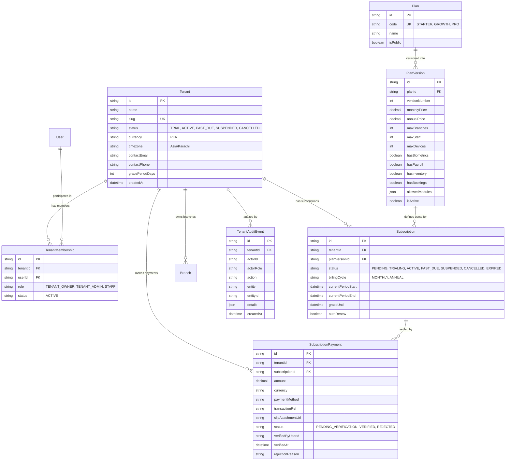

# SalonSys Platform Portal — Technical Product Architecture & AI Studio Implementation Guide

**Document Version:** 2.0.0 (Master Handoff & Technical Specification)  
**Target Audience:** AI Studio Engineer, Senior Full-Stack Developers, SaaS Platform Architect  
**Companion Document:** [`newdesign.md`](./newdesign.md) (Platform Portal Visual Design System)  
**Source Code Baseline:** Existing SalonSys Repository (`backend/`, `frontend/`, `schema.prisma`, `AGENTS.md`)

---

## 1. Executive Summary, Purpose & Boundaries

### 1.1 Purpose
SalonSys is an enterprise-grade multi-branch salon management system undergoing transformation into a high-scale multi-tenant SaaS platform. 

The **Platform Portal (`platform-portal`)** is the dedicated, standalone Master Control Center for the SaaS platform owner and operations team (iSysware). It governs tenant onboarding, salon subscriptions, quota enforcement, manual payment slip verification, dynamic plan configuration, and platform-level audit trails.

### 1.2 Target Users
* **Platform Super Admin (iSysware Operations):** Full authority to onboard salons, suspend non-paying tenants, publish plans, and verify bank transfer slips.
* **Platform Support / Billing Agent:** Can review pending payment receipts, inspect tenant audit events, and assist salon owners with subscription status.

### 1.3 Strict Out-of-Scope (What Belongs Elsewhere)
* **Daily Salon Operations:** POS checkout, appointment calendars, staff scheduling, bridal packages, cash drawer floats, customer loyalty, and daily inventory movements belong exclusively to **Portal 2 (Salon Operations App)**.
* **Direct Database Manipulation:** The Platform Portal browser application must **NEVER** connect directly to PostgreSQL or run Prisma queries directly. All mutations and reads occur strictly via authenticated backend REST endpoints.
* **Cross-Contamination:** Platform administration code, global tenant lists, wholesale pricing formulas, or platform admin tokens must **NEVER** be packaged or leaked into the Salon Client's frontend bundle. *(Verified from `AGENTS.md: Section 1.4`)*

---

## 2. Decoupled Multi-Portal Architecture

Following **Option 2 (Decoupled Physical Architecture)** mandated in `AGENTS.md`, the platform maintains strict physical and logical boundaries:

```
+---------------------------------------------------------------------------------------------------------+
|                                         PLATFORM ARCHITECTURE                                           |
+---------------------------------------------------------------------------------------------------------+
|                                                                                                         |
|   +------------------------------------+             +------------------------------------+             |
|   |   PORTAL 1: PLATFORM MASTER ADMIN   |             |   PORTAL 2: SALON OPERATIONS APP   |             |
|   |      (Standalone Vite/React App)   |             |      (Existing Vite/React App)     |             |
|   |         Proposed Port: 3002        |             |         Active Port: 3001          |             |
|   |      Target: admin.salonos.com     |             |       Target: app.salonos.com      |             |
|   +------------------------------------+             +------------------------------------+             |
|                     |                                                  |                                |
|   Platform Admin    | Bearer JWT                                       | Scoped Tenant Bearer JWT       |
|   API Calls Only    | (Role: SUPER_ADMIN)                              | (Role: ADMIN / STAFF)          |
|                     v                                                  v                                |
|   +---------------------------------------------------------------------------------------+             |
|   |                         UNIFIED BACKEND ENGINE (Node.js/Express)                       |             |
|   |                               Active Port: 5000                                       |             |
|   |                                                                                       |             |
|   |   /api/v1/platform/*                          /api/v1/tenant/* & /api/v1/*            |             |
|   |   [authenticate, authorize('SUPER_ADMIN')]    [authenticate, tenantContextMiddleware] |             |
|   +---------------------------------------------------------------------------------------+             |
|                                             |                                                           |
|                                      Prisma ORM 5.22.x                                                  |
|                                             v                                                           |
|   +---------------------------------------------------------------------------------------+             |
|   |                    SHARED POSTGRESQL DATABASE (PostgreSQL 18.x)                       |             |
|   |                                                                                       |             |
|   |   Platform Control Plane:              Tenant Scoped Data:                            |             |
|   |   - Tenant, TenantMembership           - Branch, Client, Staff, Service               |             |
|   |   - Plan, PlanVersion                  - Appointment, Booking, Invoice                |             |
|   |   - Subscription, SubscriptionPayment  - CashDrawer, StockMovement, Ledger            |             |
|   |   - TenantAuditEvent                   (All indexed and constrained by tenantId)      |             |
|   +---------------------------------------------------------------------------------------+             |
|                                                                                                         |
+---------------------------------------------------------------------------------------------------------+
```

---

## 3. Complete Verified Tech Stack & Dependency Specification

To guarantee 100% architectural harmony, the Platform Portal must use the **exact same technology stack, package versions, and styling engines** as the existing codebase.

### 3.1 Stack Summary Table
*(Verified from `frontend/package.json` and `backend/package.json`)*

| Layer | Technology | Exact Version | Justification & Verification Source |
| :--- | :--- | :--- | :--- |
| **Frontend Framework** | React | `^19.0.1` | Verified from `frontend/package.json:36` |
| **DOM Engine** | React-DOM | `^19.0.1` | Verified from `frontend/package.json:37` |
| **Build Tool / Bundler** | Vite | `^8.3.0` | Verified from `frontend/package.json:39` |
| **Vite React Plugin** | `@vitejs/plugin-react`| `^6.1.1` | Fast HMR & React 19 JSX runtime (`frontend/package.json:26`) |
| **CSS Engine** | Tailwind CSS v4 | `^4.3.3` | Unified styling via `@tailwindcss/vite` (`frontend/package.json:25, 49`) |
| **Language** | TypeScript | `^7.0.2` | Strict type checking (`frontend/package.json:51`) |
| **Component Primitives**| Radix UI | Radix UI suite | `@radix-ui/react-dialog` (^1.1.23), `@radix-ui/react-dropdown-menu` (^2.1.24), `@radix-ui/react-select` (^2.3.7), `@radix-ui/react-tabs` (^1.1.21), `@radix-ui/react-tooltip` (^1.2.16), `@radix-ui/react-checkbox` (^1.3.11), `@radix-ui/react-alert-dialog` (^1.1.23), `@radix-ui/react-separator` (^1.1.15), `@radix-ui/react-slot` (^1.3.3) |
| **Iconography** | Lucide React | `^0.546.0` | Full icon set matching SalonSys (`frontend/package.json:34`) |
| **Micro-Animations** | Motion (Framer) | `^12.23.24` | Smooth drawer & modal animations (`frontend/package.json:35`) |
| **Styling Utilities** | CVA + Clsx + Merge | `cva: ^0.7.1`, `clsx: ^2.1.1`, `tailwind-merge: ^3.7.0` | Variant class management (`frontend/package.json:27, 28, 38`) |
| **Document/Export** | jsPDF + Canvas + XLSX | `jspdf: ^4.2.1`, `html2canvas-pro: ^2.5.2`, `xlsx: ^0.18.5` | Exporting audit logs and receipt proofs (`frontend/package.json:31-33, 40`) |
| **Backend Runtime** | Node.js | `>= 22.x / 24.x` | Native ESM modules (`backend/package.json:5`) |
| **Backend Framework** | Express | `^5.2.1` | REST API routing (`backend/package.json:40`) |
| **Database ORM** | Prisma Client | `^5.22.0` | Database schema & queries locked to 5.22.x (`backend/package.json:34, 44`) |
| **Database Engine** | PostgreSQL | `18.x` | Relational multi-tenant engine (`AGENTS.md: Section 2`) |
| **Security & Auth** | Bcrypt + JWT + Helmet | `bcrypt: ^6.0.0` (12 rounds), `jsonwebtoken: ^9.0.3`, `helmet: ^8.3.0` | Token verification & password hashing |
| **Numeric Precision** | Decimal.js | `^10.6.0` | Exact financial calculations; no floating point math (`backend/package.json:38`) |

### 3.2 Network Topology & Port Bindings

| Node | Environment | Port | Protocol | Binding Address | Description |
| :--- | :--- | :--- | :--- | :--- | :--- |
| **Backend API** | Node/Express | `5000` | HTTP | `0.0.0.0:5000` | Single unified REST API engine (`backend/src/server.js:41`) |
| **Salon Operations App**| React/Vite | `3001` | HTTP | `0.0.0.0:3001` | Salon tenant portal (`frontend/package.json:7`) |
| **Platform Master Portal**| React/Vite | `3002` | HTTP | `0.0.0.0:3002` | Independent platform admin application |
| **PostgreSQL Database**| PostgreSQL | `5432` | TCP | `localhost:5432` | Shared database (`salon_saas_db`) |

### 3.3 Platform Portal `package.json` Blueprint (Ready-to-Paste)
AI Studio developer should place this exact `package.json` into `platform-portal/package.json`:

```json
{
  "name": "salonos-platform-portal",
  "private": true,
  "version": "1.0.0",
  "type": "module",
  "scripts": {
    "dev": "vite --port=3002 --host=0.0.0.0",
    "build": "vite build",
    "preview": "vite preview",
    "lint": "tsc --noEmit"
  },
  "dependencies": {
    "@radix-ui/react-alert-dialog": "^1.1.23",
    "@radix-ui/react-checkbox": "^1.3.11",
    "@radix-ui/react-dialog": "^1.1.23",
    "@radix-ui/react-dropdown-menu": "^2.1.24",
    "@radix-ui/react-label": "^2.1.15",
    "@radix-ui/react-select": "^2.3.7",
    "@radix-ui/react-separator": "^1.1.15",
    "@radix-ui/react-slot": "^1.3.3",
    "@radix-ui/react-tabs": "^1.1.21",
    "@radix-ui/react-tooltip": "^1.2.16",
    "@tailwindcss/vite": "^4.3.3",
    "@vitejs/plugin-react": "^6.1.1",
    "class-variance-authority": "^0.7.1",
    "clsx": "^2.1.1",
    "html2canvas-pro": "^2.5.2",
    "jspdf": "^4.2.1",
    "lucide-react": "^0.546.0",
    "motion": "^12.23.24",
    "react": "^19.0.1",
    "react-dom": "^19.0.1",
    "tailwind-merge": "^3.7.0",
    "vite": "^8.3.0",
    "xlsx": "^0.18.5"
  },
  "devDependencies": {
    "@types/node": "^22.14.0",
    "@types/react": "^19.3.0",
    "@types/react-dom": "^19.3.0",
    "tailwindcss": "^4.3.3",
    "typescript": "^7.0.2"
  }
}
```

---

## 4. Complete Platform Portal Feature Inventory

The Platform Portal delivers 9 comprehensive capability suites for SaaS platform operations:

### Feature 1: Executive Intelligence & MRR Pulse Dashboard
* **Real-time Counters:** Active Salons, Trial Salons, Suspended Salons, Total Branches, Total Active Staff.
* **Estimated MRR Gauge:** Real-time formula calculating total Monthly Recurring Revenue across active subscribers:
  $$\text{Estimated MRR} = \sum_{\text{sub} \in \text{Active Subscriptions}} \text{sub.planVersion.monthlyPrice}$$
* **Pending Attention Widget:** Direct alerts for pending payment proofs waiting for verification.
* **Audit Activity Stream:** Live chronological timeline of latest tenant registrations and suspensions.

### Feature 2: Tenant Fleet Directory & Deep Inspector
* **Live Fleet Table:** Comprehensive listing of all salon companies with slug, status, owner name, owner phone, active plan, branch count, and renewal countdown.
* **Instant Fleet Search:** Debounced instant search by salon name, slug, owner email, or mobile number.
* **Status Filter Segment:** Clean segmented filter: `All` | `Active` | `Trial` | `Past Due` | `Suspended` | `Cancelled`.
* **Deep Tenant Inspection Modal:** Detailed view showing the salon's assigned branches, active user roster, current subscription period dates, and historical audit events.

### Feature 3: 4-Step Atomic Onboarding Wizard
* **Zero Partial Setup Guarantee:** Atomic transaction provisions Tenant, Branch, Owner User, Membership, Subscription, and Audit in a single step.
* **Live Slug Validation:** Real-time check to prevent URL slug collisions across salons.
* **Temporary Credential Generator:** Secure random password generator with 1-click clipboard copy to share with the salon owner.
* **Initial Plan Assignment:** Immediate link to an approved active SaaS plan version.

### Feature 4: Tenant Lifecycle Controls & Kill-Switch
* **1-Click Tenant Suspension:** Instantly transitions tenant to `SUSPENDED` and synchronizes subscriptions.
* **Server-Side Lockout:** Suspended salons immediately receive HTTP 403 on all operational APIs (`tenantContextMiddleware`), blocking cashier checkout and appointment bookings.
* **1-Click Reactivation:** Instantly restores full operational rights upon payment receipt.

### Feature 5: Payment Proof Verification Desk
* **Split-Screen Verification Desk:** High-resolution slip viewer on the left (with zoom, rotate, and pan tools) paired with claimed payment metadata on the right.
* **Duplicate Prevention:** Inspection of transaction reference numbers and bank timestamps.
* **1-Click Approval:** Updates payment to `VERIFIED`, extends `currentPeriodEnd` by +1 month or +1 year, and writes audit event.
* **Rejection with Reason:** Prompts admin for mandatory rejection reason (e.g., "Illegible receipt", "Amount mismatch") and notifies tenant.

### Feature 6: SaaS Plan Catalogue & Version Builder
* **Multi-Plan Catalogue:** Management of standard commercial tiers (`Starter`, `Growth`, `Enterprise / Pro`).
* **Immutable Plan Versions:** When pricing or quotas change, a new immutable version is published. Existing salons remain undisturbed on their contracted version.
* **Dynamic Module Entitlements:** Visual matrix of checkboxes enabling or disabling individual operational modules per plan.
* **Quota Limits Configuration:** Setting numeric caps for branches, staff, and POS devices.

### Feature 7: Custom VIP Plan Overrides
* **Tailored Enterprise Contracts:** Ability to create custom, unlisted plan versions for large salon chains with custom module bundles, custom branch quotas, and negotiated monthly rates.

### Feature 8: Global Platform Audit Trail
* **Forensic Ledger:** Immutable log of all administrative actions (`TENANT_PROVISIONED`, `TENANT_STATUS_UPDATED`, `PAYMENT_VERIFIED`, `PLAN_VERSION_PUBLISHED`).
* **Metadata Diff Inspection:** Ability to click any audit row and view the before/after JSON snapshot and the admin actor's ID.

### Feature 9: Platform Deposit Settings & Bank Instructions
* **Payment Destination Management:** Configuration of platform bank accounts (Bank name, IBAN, Account title) and mobile wallets (JazzCash, EasyPaisa) displayed to salon owners for renewal deposits.

---

## 5. Dynamic Plans, Quotas & Module Entitlements Engine

SalonSys features a powerful, dynamic entitlement system where feature access is governed centrally at the plan and tenant level.

### 5.1 The 14 Granular System Modules
The backend recognizes 14 distinct functional modules. Each plan version specifies an `allowedModules` JSON array containing a subset of these keys:

```
+---------------------------------------------------------------------------------------------------+
| SALONSYS DYNAMIC MODULES MATRIX                                                                   |
+---------------------------------------------------------------------------------------------------+
| Key            | Module Name               | Description & Included Functionality                 |
|----------------|---------------------------|------------------------------------------------------|
| 'pos'          | Point of Sale & Billing   | POS billing counter, split cash/bank payments,       |
|                |                           | invoice printing, dues collection, reversals.        |
| 'services'     | Service Catalogue         | Services list, categories, durations, prices.        |
| 'packages'     | Package Bundles           | Multi-service bundled packages & revenue allocation. |
| 'clients'      | Client Management         | Client directory, customer profile, visit history,   |
|                |                           | loyalty tracking, client khata / dues.               |
| 'appointments' | Appointments & Calendar   | Daily appointment calendar, stylist slot booking,    |
|                |                           | queue management, conflict checking.                 |
| 'bookings'     | Bridal & Event Bookings   | Event date reservations, advance deposit ledger,     |
|                |                           | installment receipts, POS invoice handoff.           |
| 'cash'         | Cash Registers & Drawers  | Cash drawer custody, shift opening/closing floats,   |
|                |                           | cash float transfers, register balance audits.       |
| 'inventory'    | Stock & Purchasing        | Product catalog, stock-in purchases, supplier khata, |
|                |                           | vendor returns, batch counts, stock settlements.     |
| 'expenses'     | Expense Management        | Salon expense vouchers, categories, petty cash.      |
| 'attendance'   | Staff Shifts & Attendance | Daily clock-in/out, shift schedules, overtime,       |
|                |                           | approved leave management, official holidays.        |
| 'payroll'      | Payroll Engine            | Monthly salary calculation, commission additions,    |
|                |                           | advance loan deductions, printable payslips.         |
| 'commission'   | Commission Calculation    | Tiered stylist service & product commission rules.   |
| 'tips'         | Tip Pooling & Payouts     | Tip collection receipts, tip distribution logs.      |
| 'reports'      | Reports & General Ledger  | Daily sales summary, P&L operating statements,       |
|                |                           | tax reports, audit logs, double-entry ledger.        |
+---------------------------------------------------------------------------------------------------+
```

### 5.2 Plan Quotas & Hardware Flags
In addition to module toggles, each `PlanVersion` record enforces quantitative limits:

* **`maxBranches` (Integer):** Total physical branches the salon can create (e.g. `1` for Starter, `3` for Growth, `999` for Enterprise).
* **`maxStaff` (Integer):** Total active staff profiles permitted (e.g. `10` for Starter, `25` for Growth, `100` for Enterprise).
* **`maxDevices` (Integer):** Total authorized POS terminal / hardware tokens.
* **`hasBiometrics` (Boolean):** Hardware sync with ZKTeco attendance biometric machines.
* **`hasCustomSms` (Boolean):** Automated branded SMS confirmations & marketing reminders.
* **`hasInventory` (Boolean):** Access to retail inventory & supplier khata.
* **`hasBookings` (Boolean):** Access to advance bridal/event booking ledger.
* **`hasPayroll` (Boolean):** Access to automated monthly payroll calculations.

### 5.3 Typical Commercial Plan Profiles (Reference Specification)

> [!NOTE]
> Commercial retail prices in PKR require final stakeholder confirmation. The technical architecture supports dynamic custom pricing per version.

```
+---------------------------------------------------------------------------------------------------+
| TYPICAL SAAS PLAN TIERS (DYNAMICALLY CONFIGURED IN PLATFORM PORTAL)                               |
+---------------------------------------------------------------------------------------------------+
| Attribute        | STARTER PLAN            | GROWTH PLAN             | ENTERPRISE / PRO PLAN      |
|------------------|-------------------------|-------------------------|----------------------------|
| Code             | STARTER                 | GROWTH                  | PRO                        |
| Proposed Price   | PKR 8,000 / month       | PKR 15,000 / month      | PKR 25,000 / month         |
| Max Branches     | 1 Branch                | 3 Branches              | Unlimited (e.g. 50)        |
| Max Staff        | Up to 10 Stylists       | Up to 25 Stylists       | Unlimited (e.g. 200)       |
| Max Devices      | 1 POS Counter           | 3 POS Counters          | 10 POS Counters            |
| Biometrics       | No (false)              | Optional Add-on         | Yes (true)                 |
| Custom SMS       | No (false)              | Yes (true)              | Yes (true)                 |
| Included Modules | pos, services, clients, | All Starter modules +   | ALL 14 MODULES UNLOCKED    |
|                  | appointments, cash,     | packages, bookings,     | (Full ERP suite +          |
|                  | expenses, reports       | inventory, attendance,  | advanced financial ledger) |
|                  |                         | commission, tips        |                            |
+---------------------------------------------------------------------------------------------------+
```

### 5.4 Backend Runtime Entitlement Enforcement
Entitlements are not just UI cosmetic toggles—they are enforced server-side on every request:

1. **Authentication Token Payload:** When a salon user authenticates, the backend embeds the tenant's active plan version entitlements into the JWT payload:
   ```json
   {
     "userId": "usr-123",
     "tenantId": "tnt-456",
     "role": "ADMIN",
     "allowedModules": ["pos", "services", "clients", "appointments", "cash"]
   }
   ```
2. **`moduleGuard` Middleware:** Any route requiring a specific module verifies:
   ```javascript
   export const requireModule = (moduleKey) => (req, res, next) => {
     const allowed = req.tenantContext?.allowedModules;
     if (allowed && !allowed.includes(moduleKey)) {
       throw forbidden('MODULE_NOT_ENTITLED', `Access Denied: Your salon plan does not include the '${moduleKey}' module.`);
     }
     next();
   };
   ```
3. **Quota Checks on Creation:** Attempting to create a branch beyond `maxBranches` or add a staff member beyond `maxStaff` rejects the POST request with HTTP 403 (`QUOTA_EXCEEDED`).

---

## 6. Verified Data Models & Database Relationships

The following models constitute the SaaS Control Plane in `backend/prisma/schema.prisma`:

### 6.1 Entity Relationship Diagram (Mermaid)



---

## 7. Backend API Integration Matrix

### 7.1 API Endpoints Inventory
*(All paths mounted under `http://localhost:5000/api/v1`)*

| Method | Endpoint | Purpose & Description | Required Auth Role | Implementation Status |
| :--- | :--- | :--- | :--- | :--- |
| `POST` | `/auth/login` | Authenticate Super Admin operator | Unauthenticated (Body: `portal: 'SUPER_ADMIN'`) | `Already implemented — source se verified` |
| `POST` | `/auth/refresh` | Refresh expired access token | HttpOnly Refresh Cookie | `Already implemented — source se verified` |
| `POST` | `/auth/logout` | Terminate platform admin session | Bearer JWT | `Already implemented — source se verified` |
| `GET` | `/platform/stats` | Executive dashboard KPI counters & MRR | `SUPER_ADMIN` | `Already implemented — source se verified` |
| `GET` | `/platform/tenants` | List all salons, owners, subscriptions | `SUPER_ADMIN` | `Already implemented — source se verified` |
| `POST` | `/platform/tenants` | Atomic provisioning of new salon company | `SUPER_ADMIN` | `Already implemented — source se verified` |
| `PATCH` | `/platform/tenants/:id/status` | Suspend or reactivate salon tenant | `SUPER_ADMIN` | `Already implemented — source se verified` |
| `GET` | `/platform/plans` | Fetch plan catalogue and version history | `SUPER_ADMIN` | `Already implemented — source se verified` |
| `POST` | `/platform/plans` | Create and publish new SaaS plan | `SUPER_ADMIN` | `Already implemented — source se verified` |
| `PATCH` | `/platform/plans/versions/:vId` | Update pricing, quotas, or modules | `SUPER_ADMIN` | `Already implemented — source se verified` |
| `GET` | `/platform/payments/pending` | Fetch unverified customer payment slips | `SUPER_ADMIN` | `Already implemented — source se verified` |
| `POST` | `/platform/payments/:id/verify` | 1-Click approve slip & extend period | `SUPER_ADMIN` | `Already implemented — source se verified` |
| `POST` | `/platform/payments/:id/reject` | Reject slip with mandatory reason | `SUPER_ADMIN` | `Already implemented — source se verified` |
| `GET` | `/platform/tenants/:id` | Fetch single tenant deep profile | `SUPER_ADMIN` | `Proposed API contract — planned backend route` |
| `GET` | `/platform/audit-logs` | Global administrative audit stream | `SUPER_ADMIN` | `Proposed API contract — planned backend route` |
| `GET` | `/platform/settings` | Read/update platform bank accounts | `SUPER_ADMIN` | `Proposed API contract — planned backend route` |

---

## 8. Security, Authentication & Isolation Rules

1. **Bearer Token Authentication:** Every request to `/api/v1/platform/*` must include `Authorization: Bearer <token>`.
2. **Server-Side Authorization Enforcement:** The Express router applies `router.use(authenticate, authorize('SUPER_ADMIN'))`. Any missing, tampered, or non-superadmin token receives an immediate HTTP 403 Forbidden.
3. **No Direct Database Access:** The frontend communicates only with `/api/v1/platform/*`. Under no circumstances should database credentials or Prisma clients be bundled in the browser.
4. **Slip Attachment Security:** Slip URLs are stored as file paths or cloud storage URLs (`slipAttachmentUrl`). In production, files must be served through authenticated, signed URLs to prevent public indexing of private bank slips.
5. **Privileged Action Auditing:** Every administrative modification (tenant created, tenant suspended, slip verified, plan updated) automatically inserts a record into `TenantAuditEvent` with `actorId`, `actorRole`, and `details`.

---

## 9. AI Studio Step-by-Step Implementation Sequence

The developer building the Platform Portal in AI Studio should execute the project in these 7 sequential milestones:

1. **Milestone 1 — Setup & Layout Shell:**
   * Initialize Vite + React 19 + Tailwind v4 using the exact `package.json` in Section 3.3.
   * Implement the ambient lighting background and frosted glass card elevation tokens from [`newdesign.md`](./newdesign.md).
   * Create `PlatformSidebar` (dual-mode pill dock and expanded glass) and `PlatformHeader`.
2. **Milestone 2 — Authentication & State:**
   * Build `/login` form calling `POST /api/v1/auth/login` with `{ identifier, password, portal: 'SUPER_ADMIN' }`.
   * Store token and configure Axios / Fetch interceptor to inject `Bearer <token>`.
   * Add private route guard redirecting unauthorized users to `/login`.
3. **Milestone 3 — Executive Dashboard:**
   * Fetch `GET /api/v1/platform/stats`.
   * Render Velvet Hero Cards (MRR, Total Salons, Pending Slips) and Frosted KPI Cards (Branches, Users).
4. **Milestone 4 — Tenant Management Fleet:**
   * Fetch `GET /api/v1/platform/tenants`.
   * Render high-density `.platform-records` table with search and status filter pills.
   * Add 1-click status switcher calling `PATCH /api/v1/platform/tenants/:id/status`.
5. **Milestone 5 — Atomic Onboarding Wizard:**
   * Build 4-step modal form validating salon name, unique slug, owner credentials, and plan selection.
   * Submit to `POST /api/v1/platform/tenants`. Display copyable credentials on success.
6. **Milestone 6 — Payment Verification Desk:**
   * Fetch `GET /api/v1/platform/payments/pending`.
   * Implement split-screen slip viewer with image zoom/rotation.
   * Connect Approve button to `POST /api/v1/platform/payments/:id/verify`.
   * Connect Reject button to `POST /api/v1/platform/payments/:id/reject`.
7. **Milestone 7 — Dynamic Plan Builder:**
   * Fetch `GET /api/v1/platform/plans`.
   * Build interactive version builder with sliders for quotas (`maxBranches`, `maxStaff`, `maxDevices`) and the 14 module entitlement checkboxes.
   * Submit changes via `POST /api/v1/platform/plans` or `PATCH /api/v1/platform/plans/versions/:vId`.

> [!WARNING]
> **NO MOCK-ONLY IMPLEMENTATIONS:**  
> The developer must connect directly to the running backend on port 5000. Do not leave mock dummy data in place of live API calls. Every screen must handle live Loading (`Skeleton`), Empty (`Zero Tenants Found`), and Error (`HTTP 500 / 403 Alert`) states cleanly.
